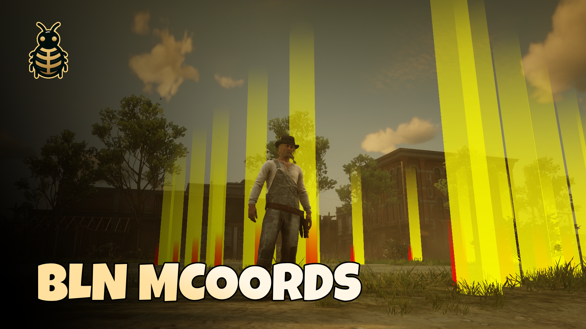

# bln_multicoords

A simple developer resource for RedM that allows you to collect multiple coordinates at once, by walking around the map. Perfect for creating locations, spawn points, or any other position-based data for your RedM scripts.



## Demo

[Video Preview](https://youtu.be/QSGFewxUQ60)

## Features

🎯 Collect coordinates (vector4, vector3, or vector2) by walking or camera aiming  
🎨 Visual markers showing collected points  
🧭 Direction indicators showing heading  
🚫 Prevents duplicate/too close positions  
📋 Result card with one-click copy (CEF-safe) and **Collect again**  
💬 On-screen notifications for actions  
⚡ Simple to use with basic commands  
🔄 Clean and optimized code

## Installation

1. Download the resource
2. Place `bln_multicoords` folder in your resources directory
3. Add `ensure bln_multicoords` to your server.cfg


## Usage

1. Start collecting coordinates:
  ```
   /mcoords
  ```
   or
   optional while in aim mode:
2. Controls:
  - `/mcoords`: `ENTER` - Add current position and heading to the list
  - `/mcoordsaim`: `MOUSE LEFT CLICK` - Add the current aimed hit position
  - `/mcoordsfly`: Toggle fly movement (W/A/S/D + jump/crouch, hold sprint for faster speed)
  - `BACKSPACE` - Finish collecting and open the coords card (use **Copy** or select text manually)
3. Visual Feedback:
  - `Crosshair (+)` appears in center while using `/mcoordsaim`
  - `Yellow markers` show collected positions
  - `Red markers` indicate heading direction of a coord.
  - Text notifications appear for actions


## Example Output

```lua
{
    vector4(-1245.12, 2687.32, 62.94, 175.45),
    vector4(-1267.89, 2699.54, 63.12, 89.67),
    vector4(-1289.34, 2701.87, 63.45, 265.89),
}
```

or whatever format you set in config: v4, v3, v2.

## Notes

- The resource prevents collecting duplicate points that are too close to each other (within 1.0 units)
- After finishing, a NUI card shows your coords; **Copy**, **Collect again** (same mode as last run), or close with **X** / **Esc**
- Visual markers remain visible while collecting to help visualize the path
- Heading is shown with a red marker pointing in the facing direction


## Support

Join our Discord for support and updates:
[https://discord.bln-studio.com](https://discord.bln-studio.com)

## License

Free to use and modify. Please retain credits if redistributing.